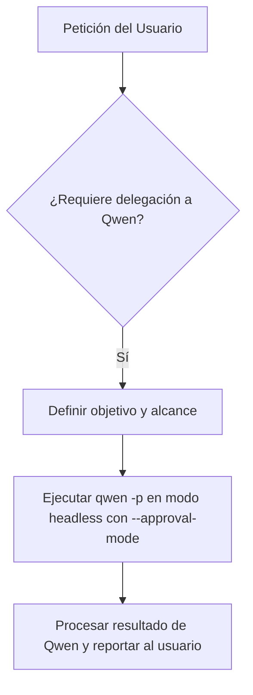

# Qwen Code: Agente Autónomo de Programación de Alibaba

Esta habilidad permite a Antigravity interactuar, orquestar y delegar tareas de desarrollo a **Qwen Code**, el agente open-source de codificación creado por el equipo de Qwen (Alibaba Cloud).

Qwen Code está instalado globalmente en el sistema y puede ejecutarse desde cualquier directorio de trabajo en modo desatendido (*headless*), en modo interactivo o como subagente de apoyo.

---

## Cuándo Usar y Cuándo NO Usar

- **Usar cuando**:
  - El usuario pida ejecutar o delegar una tarea de codificación o depuración a Qwen Code.
  - Se desee realizar una segunda opinión de arquitectura o revisión cruzada de código entre modelos.
  - Se requiera ejecutar tareas por lotes (*batch tasks*) de refactorización o generación de pruebas unitarias mediante la CLI de Qwen.
  - El usuario escriba `/qwen` o `/qwen-code` en el prompt.
- **NO usar cuando**:
  - La tarea sea una consulta conversacional simple que Antigravity puede responder directamente en un solo paso.

---

## Comandos Principales de Qwen Code en la Terminal

### 1. Ejecución Desatendida (Headless / Non-Interactive)
Para ejecutar instrucciones directamente desde Antigravity o scripts sin bloquear la terminal interactiva:

```bash
# Modo solo análisis (Plan Mode: no modifica archivos ni corre comandos destructivos)
qwen -p "Analiza la estructura de este proyecto y detecta posibles cuellos de botella" --approval-mode plan

# Modo edición automática segura (Auto-edit)
qwen -p "Genera pruebas unitarias para las funciones en src/utils.py" --approval-mode auto-edit

# Modo autónomo completo (YOLO / Auto)
qwen -p "Corrige los errores de linting reportados en el proyecto" --approval-mode auto
```

### 2. Salida Estructurada para Preservar Contexto
Para evitar saturar la ventana de contexto de Antigravity con cientos de líneas de terminal, redirige la salida o usa formato JSON:

```bash
# Guardar reporte en archivo de texto o JSON
qwen -p "Audita la seguridad de las dependencias" --output-format json > qwen_audit.json
```

### 3. Modo Interactivo en la Terminal del Usuario
Para que el usuario trabaje directamente en la interfaz TUI de Qwen:

```bash
qwen
```

---

## Configuración de Proveedores y Modelos

Qwen Code admite múltiples proveedores de LLM configurables mediante variables de entorno o la interfaz interactiva `/auth`:

| Proveedor | Variable de Entorno | Tipo de Autenticación (`--auth-type`) |
| :--- | :--- | :--- |
| **Qwen / DashScope (Alibaba)** | `DASHSCOPE_API_KEY` | `qwen-oauth` o clave API |
| **OpenAI / Modelos Compatibles** | `OPENAI_API_KEY`, `OPENAI_BASE_URL` | `openai` |
| **Google Gemini / Vertex AI** | `GEMINI_API_KEY` | `gemini` o `vertex-ai` |
| **Anthropic Claude** | `ANTHROPIC_API_KEY` | `anthropic` |
| **Modelos Locales (Ollama / vLLM)** | `OPENAI_BASE_URL=http://localhost:11434/v1` | `openai` |

---

## Flujo de Orquestación desde Antigravity



### Protocolo de Ejecución:
1. **Paso 1**: Identificar el directorio de trabajo donde debe operar Qwen.
2. **Paso 2**: Construir el comando `qwen -p "..."` con la instrucción clara y el modo de aprobación apropiado (`plan` para lectura, `auto` para cambios).
3. **Paso 3**: Ejecutar mediante `run_command`.
4. **Paso 4**: Leer el resultado devuelto por Qwen e informar al usuario con enlaces a los archivos modificados.

---

## Lista de Verificación
- [ ] `qwen --version` verificado (instalado globalmente).
- [ ] Modo de aprobación especificado explícitamente (`--approval-mode plan|auto-edit|auto`).
- [ ] Directorio de trabajo (`Cwd`) configurado en el proyecto objetivo.
