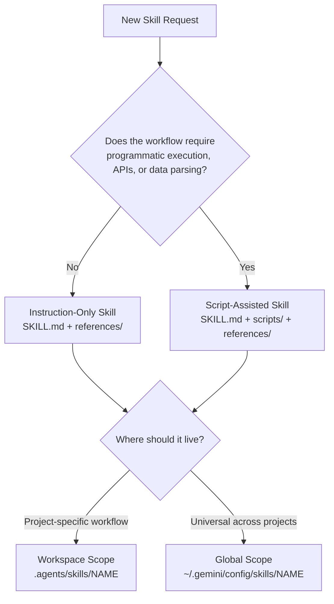

# Skill Creator (Super-Skill for Antigravity)

The **Skill Creator** is a specialized meta-skill designed to guide the creation, structuring, and validation of high-quality, production-ready agent skills for Google Antigravity (and compatible agent systems). It strictly adheres to the official [Antigravity Agent Skills Specification](./references/antigravity_spec.md).

---

## Overview

Skills are modular, reusable packages of knowledge, instructions, checklists, and optional executable scripts that teach Antigravity how to handle specific tasks. Skills follow the **Progressive Disclosure** pattern: only the metadata (`name` and `description`) is indexed upfront in the agent's context, while the full body (`SKILL.md`), reference manuals (`references/`), and tools (`scripts/`) are loaded strictly on demand when relevant.

---

## Skill Locations and Scopes

When creating a new skill, determine its scope and target path:

| Scope | Default Directory Path | Description |
| :--- | :--- | :--- |
| **Workspace (Project)** | `<workspace-root>/.agents/skills/<skill-name>/` | Scoped to the current repository; committed to VCS to share with your engineering team. *(Antigravity also maintains backward compatibility with `.agent/skills/`)* |
| **Global (User-Wide)** | `~/.gemini/config/skills/<skill-name>/` *(Windows: `C:\Users\<user>\.gemini\config\skills\<skill-name>\`)* | Available across all workspaces and projects on the workstation. |
| **CLI Global** | `~/.gemini/antigravity-cli/skills/<skill-name>/` | For users of the standalone Antigravity CLI. |
| **Plugin-Provided** | `plugins/<plugin-name>/skills/<skill-name>/` | Packaged inside a distributable Antigravity plugin. |

---

## Directory Anatomy of an Antigravity Skill

Every skill is a directory bundle containing at minimum a `SKILL.md` file:

```text
<skill-name>/
├── SKILL.md          # Required: Instructions, YAML frontmatter, protocols, checklists
├── scripts/          # Optional: Helper CLI scripts and executable automation
├── examples/         # Optional: Reference implementations and input/output samples
├── resources/        # Optional: Templates, config boilerplates, schemas, data assets
└── references/       # Optional: Deep technical docs, API specs, and extended manuals
```

---

## Step-by-Step Skill Creation Protocol

Follow this 6-phase protocol when asked to build or refine a skill:

### Phase 1: Requirements Discovery & Interview

Clarify the core purpose before writing any code or documentation. Ask the user (or deduce from context) the following key aspects:

1. **Goal & Domain**: What specific task or domain does this skill address?
2. **Pattern Selection**:
   - **Instruction-Only**: For reasoning, code-review, architecture guidelines, or coordinating existing tools without new code.
   - **Script-Assisted (CLI Pattern)**: When the workflow involves repetitive commands, API calls, file parsing, data transformations, or complex automations.
3. **Scope Target**: Workspace (`.agents/skills/`) vs. Global (`~/.gemini/config/skills/`).
4. **Triggers & Scenarios**: Under what exact user requests or situations should the agent activate this skill?

---

### Phase 2: Design & Frontmatter Engineering

The YAML frontmatter in `SKILL.md` is the **most critical component** because Antigravity's model classifier relies entirely on it to decide whether to activate the skill.

#### Frontmatter Rules:
- **`name`** (required/recommended): Lowercase, hyphenated (kebab-case), matches folder name, max 64 characters (e.g., `git-commit-helper`, `postgres-migrator`).
- **`description`** (required):
  - Must be written in **third person** (e.g., *"Analyzes...", "Generates...", "Use when..."*).
  - Must explicitly state **what** the skill does AND **when** to use it.
  - Must include actionable keywords that match user intent.
  - Can specify anti-triggers (*"Do NOT use for..."*).

*Example:*
```yaml
---
name: code-review
description: >-
  Reviews code changes for bugs, style issues, and best practices. Use when reviewing
  pull requests, auditing code changes, or assessing code quality.
---
```

---

### Phase 3: Automated Scaffolding

Use the bundled scaffolding script to generate a standardized directory structure and boilerplates:

```bash
# Workspace skill (default):
python .agents/skills/skill-creator/scripts/scaffold_skill.py --name my-new-skill --description "Performs X when Y happens." --scope workspace

# Global skill:
python .agents/skills/skill-creator/scripts/scaffold_skill.py --name my-new-skill --description "Performs X when Y happens." --scope global

# CLI-assisted skill with helper scripts:
python .agents/skills/skill-creator/scripts/scaffold_skill.py --name my-api-tool --description "Queries service Z." --type cli
```

*(Run `python scripts/scaffold_skill.py --help` for full options.)*

---

### Phase 4: Authoring `SKILL.md` (The Core Runbook)

Structure `SKILL.md` following these standard sections:

1. **Title & Overview**: Brief summary of purpose and value.
2. **When to Use & When NOT to Use**: Clear activation boundaries.
3. **Prerequisites & Dependencies**: Environment setup, required tools, or other skills referenced.
4. **Step-by-Step Instructions**: Sequential, unambiguous actions.
5. **Decision Trees & Branching**: How to choose between different methods when edge cases arise.
6. **Verification Checklist**: How the agent and user can verify that the task succeeded.
7. **Common Pitfalls & Troubleshooting**: 3-5 frequent errors and their remedies.

> [!TIP]
> **Progressive Disclosure Principle**: Keep `SKILL.md` concise (< 400 lines). If you have extensive API references, schema catalogs, or long guidelines, place them in `references/` and link to them using relative markdown links (e.g. `[Schema Spec](./references/reference.md)`). The agent will only read them when needed!

---

### Phase 5: Creating Helper Scripts (If Applicable)

When scripts are needed, follow the **CLI Black Box Pattern**:
- Build multi-command CLI scripts using standard Python `argparse`.
- Avoid unnecessary external dependencies; prioritize standard libraries (`urllib`, `json`, `pathlib`, `os`).
- Implement `--help` output so the agent can discover options without reading entire script files.
- Default to **file output** (e.g., `--output results.json`) instead of printing hundreds of lines to stdout. Stdout should only show concise status messages.
- Always implement proper error handling with exit code `1` on failure and actionable error messages on stderr.

---

### Phase 6: Validation & Quality Assurance

Run the bundled validation script to verify that the newly created skill complies with all Antigravity specifications:

```bash
python .agents/skills/skill-creator/scripts/validate_skill.py path/to/my-new-skill
```

The validator checks:
1. Valid YAML frontmatter with `name` and `description`.
2. Name formatting (lowercase kebab-case, matching folder name).
3. Description quality (length, third-person perspective, trigger keywords).
4. Relative link integrity (checks that linked scripts or references actually exist).
5. Token economy warnings (flags oversized `SKILL.md` files).

---

## Decision Matrix: Choosing the Right Skill Architecture



---

## Best Practices Checklist

- [ ] **Focused Scope**: The skill does one domain/task well.
- [ ] **Rich Description**: Includes third-person phrasing, clear triggers, and relevant domain keywords.
- [ ] **Progressive Disclosure**: Detailed manuals are split into `references/`.
- [ ] **Scripts as Black Boxes**: Scripts support `--help`, write to files, and produce clean terminal logs.
- [ ] **Verification Steps**: Each workflow includes validation criteria for checking success.
- [ ] **Slash Command Compatible**: Ready to be invoked via `/<skill-name>` or autonomously by the model.

---

## Reference Materials

- [Antigravity Official Skills Specification](./references/antigravity_spec.md)
- [Frontmatter & Description Guidelines](./references/frontmatter_best_practices.md)
- [Progressive Disclosure Architecture](./references/progressive_disclosure.md)
- [CLI Helper Script Template](./references/templates/cli_helper_template.py)
- [Workflow Skill Template](./references/templates/workflow_skill_template.md)
